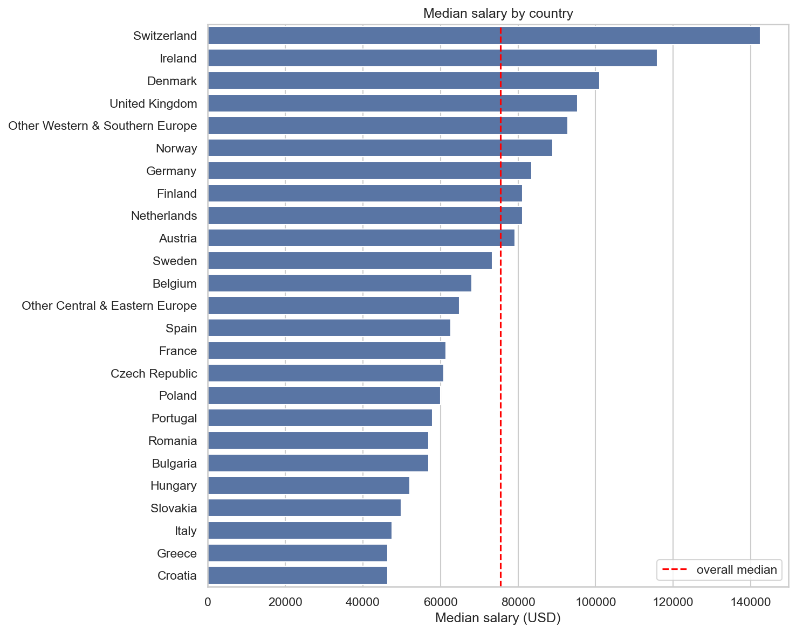
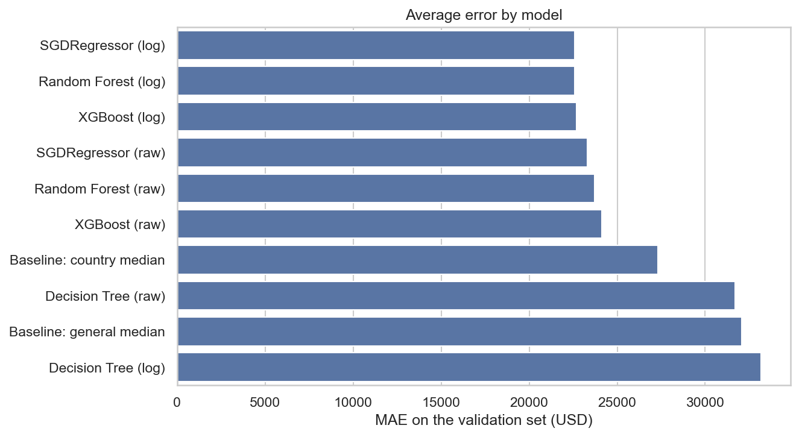
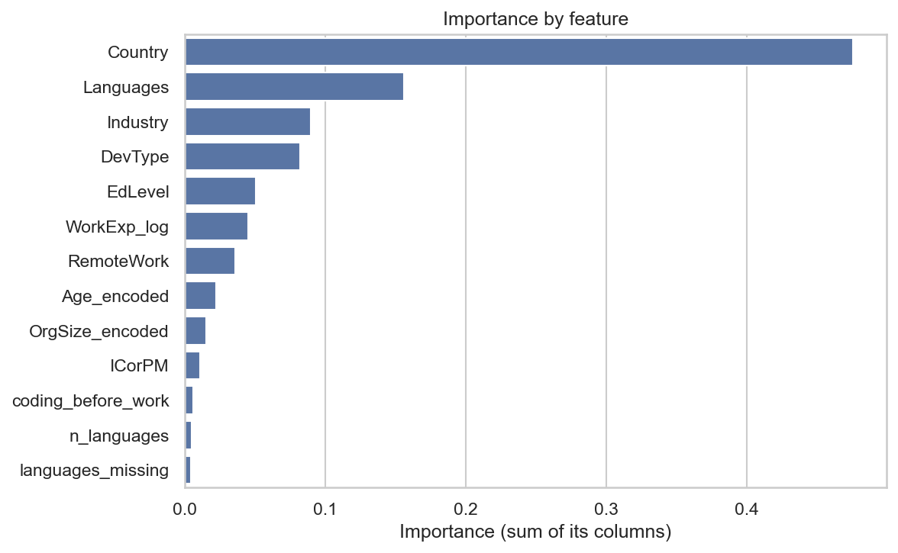
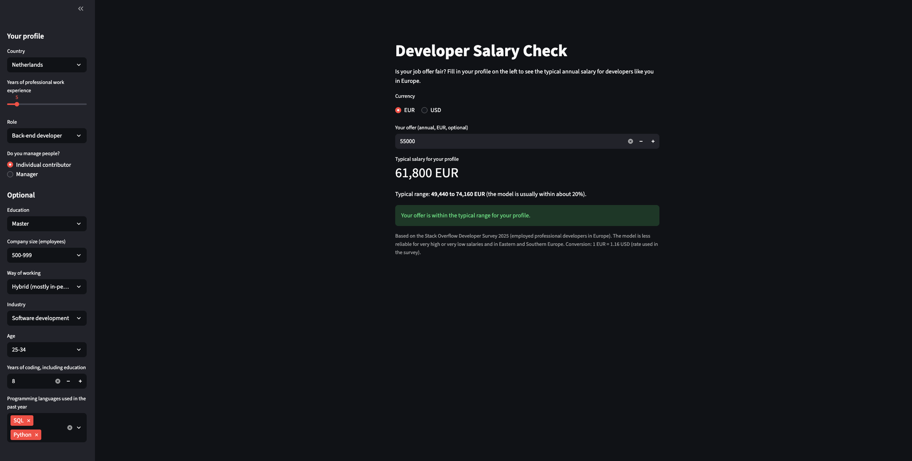

# Developer Salary Prediction

Is a job offer fair? I built a model that predicts the typical salary of a software developer in Europe from their profile: country, experience, role, education, company, way of working and programming languages.

**Result:** on unseen test data the model is off by **21,462 USD** on average. That's **22% less** error than just using the median salary of each country, and 32% less than using one median salary for everyone.

*Final project of the Ironhack Data Analytics bootcamp (Case Study 1: Data Science End to End Project).*

---

## Business problem

A developer who receives a job offer often doesn't know whether the salary is fair compared with peers who have a similar profile. My goal: predict the typical market salary for a given profile, so the offer can be compared with it.

## Data

- **Source:** [Stack Overflow Developer Survey 2025](https://survey.stackoverflow.co/), 49,191 respondents and 172 columns. The data is licensed under the [Open Database License (ODbL) 1.0](https://opendatacommons.org/licenses/odbl/).
- **Target:** `ConvertedCompYearly`, the total annual compensation converted to USD.
- **Scope:** employed professional developers living in Europe (EU-27 plus Iceland, Norway, Switzerland and the UK).

Cleaning (notebook 01), with every step documented:

| Step | Rows |
|---|---|
| Raw data | 49,191 |
| Scope filters (salary given, professional developer, employed, Europe) | 7,709 |
| Duplicates and answers that contradict the scope removed | 7,685 |
| Salary outliers removed (below 10,000 or above 500,000 USD) | 7,432 |
| Impossible experience values removed | 7,428 |

The salary outliers were real input errors: people who entered their salary in thousands ("45" for 45,000 EUR), monthly salaries, round "million" answers and extra zeros. The standard IQR rule didn't work here because salaries are skewed, so I set the limits based on these error patterns.

## Key findings (EDA)



1. **Country and experience matter most.** Salaries differ about 3 times between countries (Switzerland 142,592 vs Croatia 46,406 USD) and about 2 times between the least and most experienced developers. Experience pays off most in the first 10 to 15 years, then levels off.
2. **Career stage matters beyond experience.** Managers earn about 20% more, but about half of that comes from their extra experience: at the same experience the gap is around 9%.
3. **Where and how you work matters.** Fully remote developers earn 33% more than in-person developers, even within Germany. Finance pays the most, the public sector the least, and large companies more than small ones.
4. **Which languages, not how many.** Users of back-end and infrastructure languages (Go, Rust, Kotlin) earn more, users of web languages (PHP, HTML/CSS, JavaScript) less. The number of languages is not related to salary.
5. **These are relations, not causes.** All six hypothesis tests were significant, as expected with 7,400 rows, so I focused on how large the differences are.

## Model and results

I compared two simple baselines and four models, each trained on the raw and on the log salary. The test set (20%) stayed untouched until the end; the models were compared on a validation set taken from the training data.



*Before tuning, the three best models were tied at about 22,600 USD, so I tuned all three.*

| Model (log salary, after tuning) | MAE on validation |
|---|---|
| SGDRegressor (linear) | 22,326 USD |
| Random Forest | 22,175 USD |
| **XGBoost** | **21,155 USD** |

**Final model:** XGBoost on log salary, with shallow trees (`max_depth` 3, `learning_rate` 0.05, 700 trees). Keeping the trees shallow stopped it from memorizing the training data: the gap between training and validation R² fell from 0.41 to 0.08.

**Test set results:**

| | MAE | RMSE | R² |
|---|---|---|---|
| Baseline: one median for everyone | 31,698 USD | 47,582 USD | −0.03 |
| Baseline: median of each country | 27,510 USD | 43,508 USD | 0.14 |
| **Final model** | **21,462 USD** | **36,527 USD** | **0.39** |

What the model relies on most:



Country is by far the most important feature, about half of the total importance, which confirms the EDA. (Features with many one-hot columns, like the languages, look bigger in this chart than single-column features like experience.)

Where the model works best and worst:
- It predicts the **typical salary for a profile**: it pulls predictions toward the middle, so very low salaries come out too high and very high ones too low.
- Best for typical salaries of 60,000 to 100,000 USD (about 15% error) and in the Nordic countries; worst for very high or very low salaries (about 37%) and in Eastern and Southern Europe. For the Netherlands the typical error is about 20%.

## Recommendations

For a developer evaluating a job offer:
1. **Compare the offer with your own country.** Country has the biggest influence on salary, so comparing with other countries is misleading.
2. **Use the prediction as a range.** The typical error is about 20%. If an offer is more than 20% below the predicted salary for your profile, that's a strong signal to negotiate.
3. **Plan your career with the curve in mind.** Salary grows fast in the first 10 years and levels off after 15. Later on, higher salaries go together with role (management, architecture), industry (finance) and company size more than with extra years.
4. **Focus on the right skills.** Knowing more languages isn't related to higher pay; back-end and infrastructure skills are.
5. **Include the way of working in the negotiation.** Fully remote and flexible roles go together with higher salaries, even within one country.

The model is less reliable for very high or very low salaries and in Eastern and Southern Europe, so treat its predictions there with extra care.

## Salary calculator app

I turned the final model into a small Streamlit app. You fill in your profile (country, experience, role and whether you manage people are required, everything else is optional) and it shows the typical salary for your profile with a range of about ±20%, in EUR or USD. If you enter a job offer, it tells you whether the offer is below, within or above that range.



The app uses the saved model and the same preparation steps as notebook 03; I checked that it gives exactly the same predictions as the notebook for all 1,486 people in the test set.

## Limitations

- Only valid for employed professional developers in Europe, not for freelancers or other regions.
- Self-reported survey data from people who chose to take part.
- Salaries are converted to USD, so exchange rates affect country comparisons, and cost of living is not taken into account.
- The model explains about 39% of the salary differences on the test set. Factors like the company, the city or negotiation skills are not in the data.

## Repository structure

```
developer-salary-prediction/
├── data/
│   ├── raw/                  # original survey files (not on GitHub, see below)
│   └── processed/            # cleaned data from notebook 01
├── images/                   # charts used in this README
├── models/                   # saved final model and preprocessing
├── notebooks/
│   ├── 01_data_audit_cleaning.ipynb
│   ├── 02_eda_statistics.ipynb
│   └── 03_modeling.ipynb
├── slides/
├── app.py                    # Streamlit app (interface)
├── backend.py                # Streamlit app (model loading and prediction)
├── requirements.txt
└── README.md
```

| Notebook | Content |
|---|---|
| [01 – Data audit and cleaning](notebooks/01_data_audit_cleaning.ipynb) | Scope, data quality audit, cleaning decisions |
| [02 – EDA and hypothesis tests](notebooks/02_eda_statistics.ipynb) | Univariate and bivariate analysis, relations between features, six hypothesis tests |
| [03 – Modelling](notebooks/03_modeling.ipynb) | Preprocessing, baselines, model comparison, tuning, test results, error analysis, feature importance |

## How to run

1. Clone the repository and install the packages:
   ```bash
   git clone https://github.com/berkerild/developer-salary-prediction.git
   cd developer-salary-prediction
   pip install -r requirements.txt
   ```
2. The cleaned data is already in `data/processed/`, so notebooks 02 and 03 can be run directly.
3. To run notebook 01 as well, download the 2025 results from the [Stack Overflow survey page](https://survey.stackoverflow.co/) (the raw file is too large for GitHub) and save them in `data/raw/` as `survey_results_2025.csv` and `survey_schema_2025.csv`.
4. Run the notebooks in order, from the `notebooks/` folder. Notebook 03 takes a few minutes because of the tuning.
5. To start the salary calculator, run this from the repository folder:
   ```bash
   streamlit run app.py
   ```

## Next steps

- Publish the app online with Streamlit Community Cloud, so anyone can use it with a link.
- A range based on the typical error of each country (9% in Finland, 26% in Poland) instead of a fixed 20%.
- More currencies (GBP, CHF, PLN...).
- Add earlier survey years to have more data, especially for small countries.
